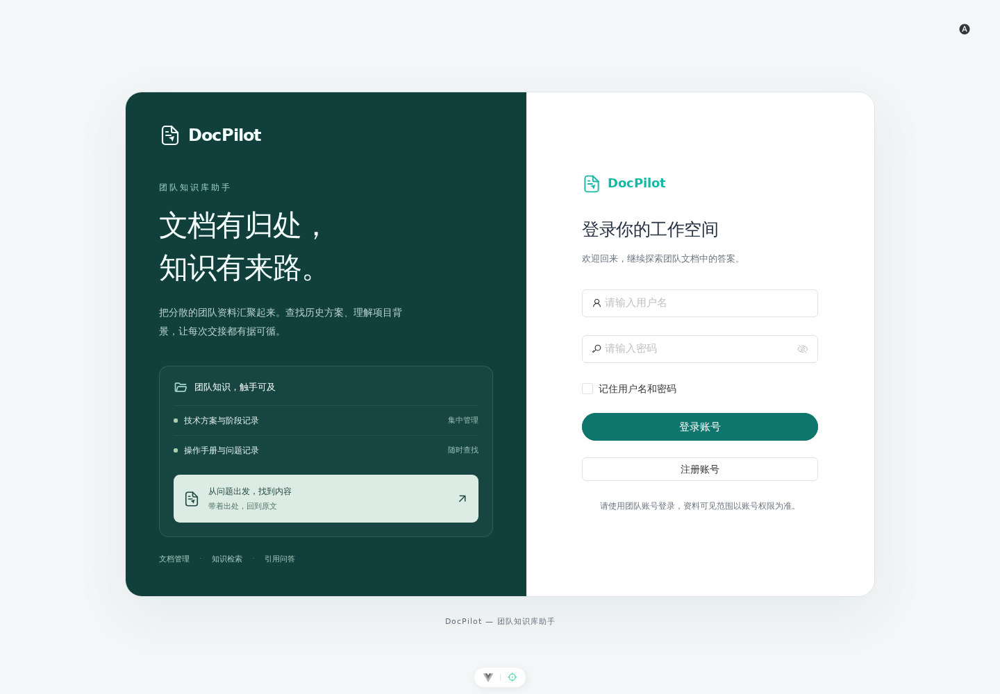
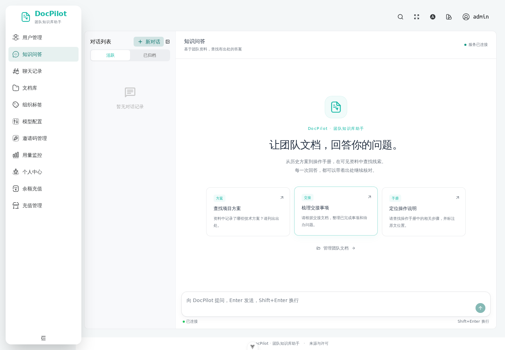
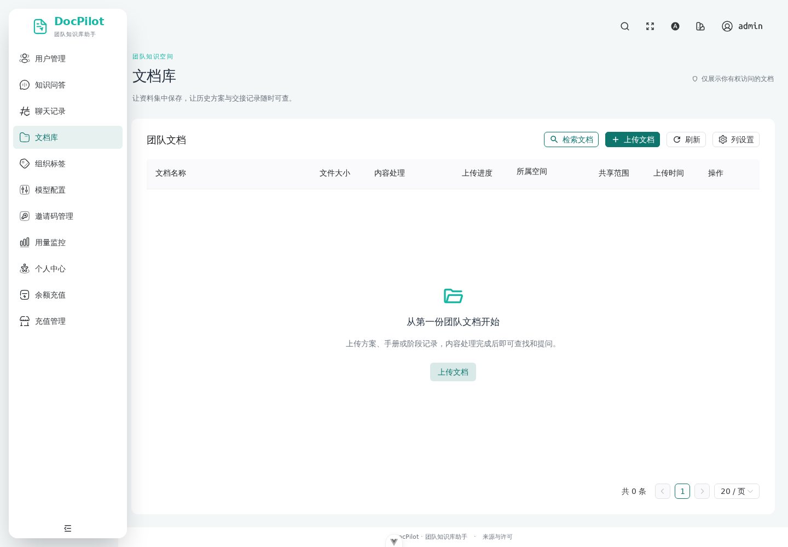
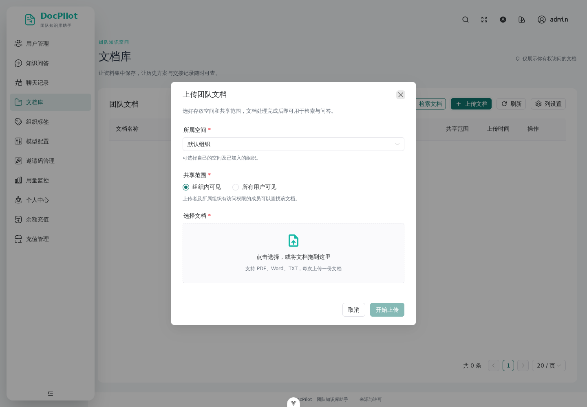
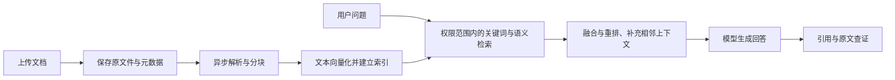

# DocPilot — 团队知识库助手

面向团队内部文档的知识检索与智能问答应用。集中保存技术方案、操作说明和阶段记录，在当前账号可见的资料中查找内容，并通过回答中的引用回到原文，帮助成员复用资料、了解项目背景和完成工作交接。

DocPilot 是基于 PaiSmart（派聪明）的界面与产品文档改造；保留原有后端、数据结构和配置兼容性。这里描述实际代码提供的能力，不代表已经完成团队部署或取得性能收益。

## 能做什么

- **管理文档**：支持 PDF、Word、TXT 的单文件上传、分片续传、列表查看、下载和适用格式的预览。
- **跟踪处理**：区分文件上传与内容处理；处理完成后可参与检索，失败时显示原因并为有管理权限的账号提供重试入口。
- **查找知识**：结合关键词和语义检索，融合、排序候选片段；可以直接查看命中内容和原文。
- **围绕资料问答**：模型可以调用知识检索工具，将片段作为回答上下文；支持流式输出、停止生成、历史对话及归档。
- **查证出处**：引用保留文件、命中片段和证据摘要，可用时定位 PDF 页码；引用存在本身不保证答案正确。
- **控制可见范围**：当前账号上传的文档、公开文档及有效组织标签匹配的文档可见。组织标签过滤不等于物理租户隔离。

只处理主动上传并被保留的资料；不会自动扫描成员电脑、找回丢失文件或重建未记录的历史决策。

## 界面预览

以下为本地浏览器实际截图。当前知识库为空，截图不代表已导入团队资料或验证真实模型回答。






## 技术栈与数据流

前端：Vue 3、TypeScript、Vite 6、Naive UI、Pinia、UnoCSS。后端：Java 17、Spring Boot 3.4.2、Spring Data JPA、Spring Security／JWT。



MinIO 保存原文件，MySQL 保存元数据、分块及持久对话，Redis 用于上传状态和短期会话，Kafka 承接异步处理，Elasticsearch 提供关键词与向量检索。PDF 使用 LiteParse；其他支持的文档由 Tika 解析。当前分块以段落、句子和字符长度规则为主。

## 启动

### 当前机器：已有隔离环境

在仓库根目录执行：

```bash
bash status-local.sh
bash start-local.sh
```

前端：<http://localhost:9527>；后端：`http://localhost:8081/api/v1`。账号凭据见本机被忽略的 `local-credentials.local.md`，不在公开文档中提供密码。

这些包装脚本依赖已有的 `/mnt/e/dev/PaiSmart/paismart.py`，不是通用安装器。组件版本、端口、停止方式和日志位置见 [本地运行说明](本地运行说明.md)。

### 其他开发环境

需要 Java 17、Maven、Node.js ≥ 18.20、pnpm ≥ 8.7，以及已可用的 MySQL、Redis、Kafka、MinIO、Elasticsearch 与 LiteParse。

```bash
# 仓库根目录：首次配置，不覆盖已有 .env
cp -n .env.example .env
# 按实际环境填写连接信息、JWT 密钥与模型配置
mvn spring-boot:run
```

另开终端，在仓库根目录执行：

```bash
cd frontend
pnpm install --frozen-lockfile
pnpm dev
```

`pnpm dev` 使用 `test` 模式，读取 `frontend/.env`、`.env.test` 和对应本地覆盖文件；通过 Vite 代理访问后端。`pnpm build` 使用 `prod` 模式。完整说明见 [配置指南](docs/CONFIGURATION.md)。

`infra.sh` 依赖本机已有的服务启动脚本，仅覆盖部分基础组件；`docs/docker-compose.yaml` 是既有基础服务模板，不是一条命令启动整套 DocPilot 的生产部署方案。

## 使用

1. 登录后进入“文档库”，选择所属空间和共享范围，上传一份允许使用的资料。
2. 等待“内容处理”显示可检索；上传完成与内容处理完成是两个阶段。
3. 使用“检索文档”查看相关片段，或在“知识问答”中围绕已入库资料提问。
4. 点击回答中的引用，核对证据片段和原文；遇到资料缺失、过期或冲突时，以原文和负责人确认为准。

注册和邀请方式由部署配置决定，团队部署请向管理员获取账号或邀请码。模型未配置时不代表系统具备真实问答／向量化能力；详见 [使用说明](docs/USAGE.md)。

## 检查、构建与部署

```bash
# frontend 目录
pnpm typecheck
# 定向检查时将路径替换为本次修改的文件；不使用带全仓自动修复的 pnpm lint
pnpm exec eslint src/views/knowledge-base/index.vue
pnpm build
pnpm preview --host 127.0.0.1
```

```bash
# 仓库根目录
mvn -q -DskipTests compile
mvn test
mvn -DskipTests package
```

`pnpm preview` 默认端口为 9725，用于检查构建产物；生产模式 `/api/v1` 和 WebSocket 需要反向代理，单独预览静态资源不代表后端可用。部署前分别验证前端、后端、数据服务及模型连接，参考 [发布说明](scripts/DEPLOY.md) 与 [Nginx 配置](docs/nginx.conf)。

本轮验证记录及限制见 [DocPilot 改造记录](docs/DOC_PILOT_CHANGELOG.md)。构建通过不等于问答、付费模型或上传全链路通过。

## 兼容性、来源与授权

外部展示统一为 **DocPilot**。Java 包 `com.yizhaoqi.smartpai`、启动类 `SmartPaiApplication`、JAR 名、API 路径、数据库名称、Redis 前缀、索引名、存储目录和现有环境变量保持兼容。

- 上游项目：[itwanger / PaiSmart](https://github.com/itwanger/PaiSmart)，原作者沉默王二及上游贡献者。
- 根目录授权文件：[LICENSE](LICENSE)；前端依赖及元数据中的授权声明继续保留，不因品牌调整重新声明原代码所有权。
- 原 README、作者资料、教程与推广历史完整保留在 [上游 README 归档](docs/history/README-PaiSmart.md)。
- [历史设计／优化记录](docs/interview-upgrade-plan.md)、[历史评测报告](docs/eval/reports/README.md)和示例语料保留原品牌及当时的结果；它们不作为本轮验证结果或 DocPilot 的效果承诺。
